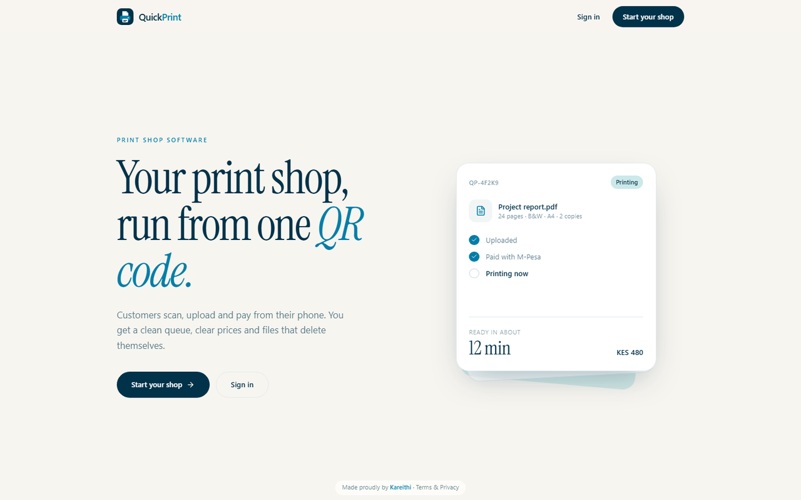
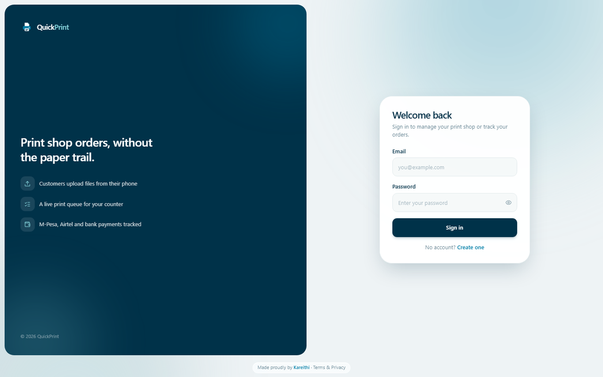
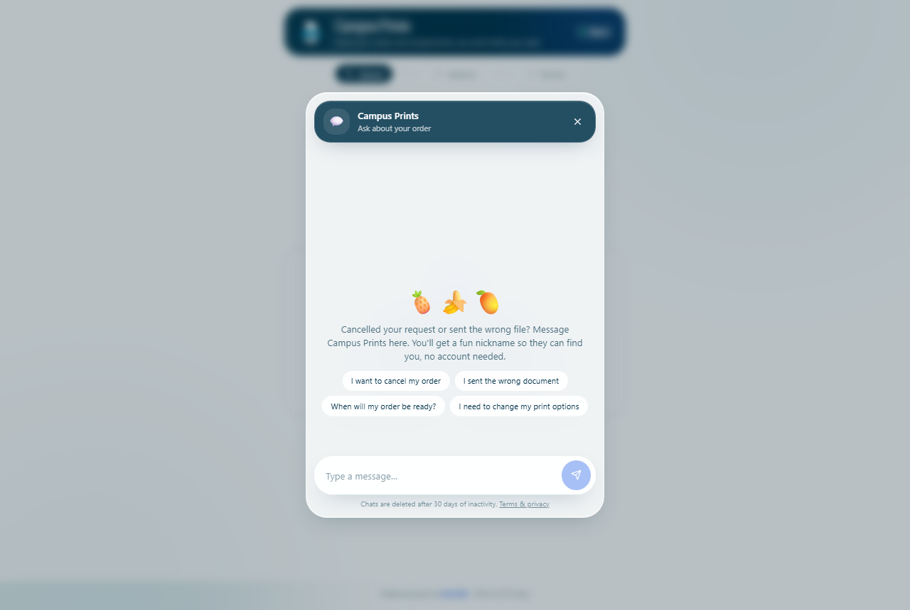
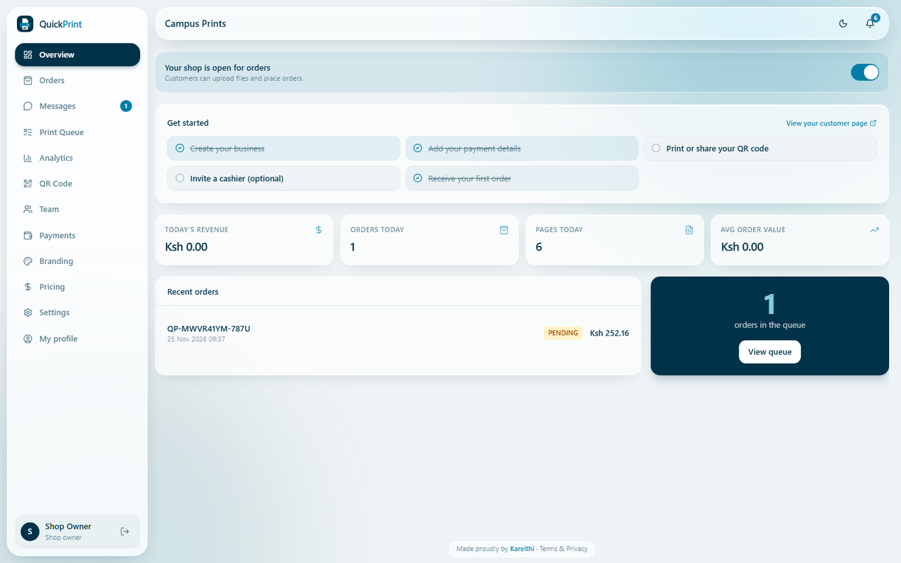
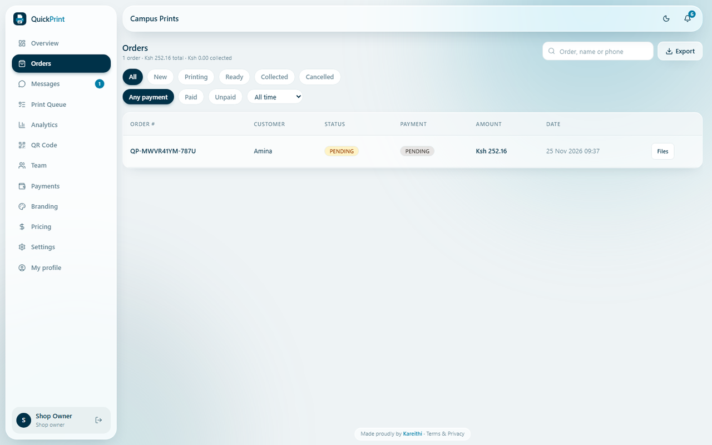
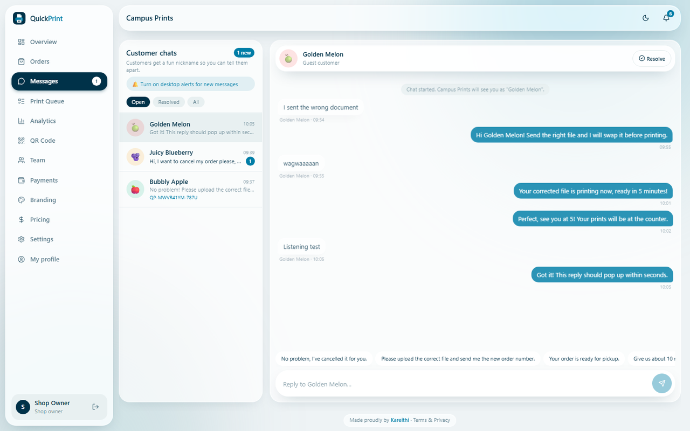
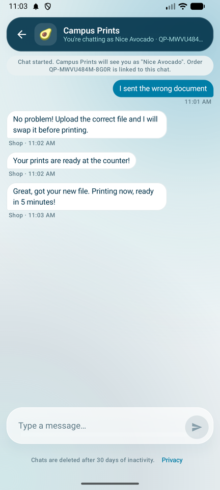

# QuickPrint Web

**A print-shop management and customer ordering portal.** QuickPrint helps cyber cafés, print shops, universities and libraries take print jobs from customers' phones, from upload through pickup, and chat with those customers.

Built with Next.js 16, React 19 and Tailwind CSS 4. Deployed at **[quickprint-ten.vercel.app](https://quickprint-ten.vercel.app)**.

| Part | Repository | What it is |
|---|---|---|
| **Website** (this repo) | [Brian-Kareithi/QuickPrint](https://github.com/Brian-Kareithi/QuickPrint) | Customer portal, shop dashboard, admin, Terms & Privacy (Vercel) |
| API | [Thee-Entity/QuickPrint-Backend](https://github.com/Thee-Entity/QuickPrint-Backend) | NestJS REST + Socket.IO (Railway) |
| Android app | [Brian-Kareithi/QuickPrint-Android](https://github.com/Brian-Kareithi/QuickPrint-Android) | Customer app: shop code / QR, upload, order, chat, reply notifications |

## Screenshots

**Landing page and sign-in**

 

**Customer upload portal** (`/shop/[slug]`) and the **chat popup** (`/shop/[slug]?chat=open`). Frosted glass over a soft brand-colour backdrop.

 

**Shop dashboard** (`/dashboard`) and **orders** (`/dashboard/orders`)

 

**Customer chats** (`/dashboard/messages`). Each customer gets a fruity nickname; the conversation has a floating glass header and composer.



**The same chat from the customer's Android phone**, and the **Terms & Privacy** page (`/terms`)

 

## Features

### For customers
- **Send files from your phone, no account needed.** Open a shop by scanning its QR poster, from its link, or (when signed in) by entering its 5-character shop code on `/send-files`.
- Shop-branded upload portal: drag-and-drop or tap to upload, per-file print options (pages, copies, colour, paper, layout, quality, binding, finishing), a live price breakdown, and cash, M-Pesa or Airtel payment instructions with your order number.
- **Chat with the shop** from a popup: cancelled your request or sent the wrong file? One-tap messages, a fun nickname such as *Cute Pineapple 🍍* instead of your name, and your order linked automatically. A toast shows the shop's reply if the chat is closed.
- **Terms & Privacy** page (`/terms`): what is collected, who sees it, how long it's kept, and your rights under the Kenya Data Protection Act 2019. Linked from the site footer, the upload box and the Android app.
- Optional customer account with order history (`/my-orders`).

### For shop owners and cashiers
- Live print queue and searchable order management with payment tracking.
- **Messages inbox** (`/dashboard/messages`): all customer chats with fruit nicknames and avatars, Open/Resolved filters, the linked order's status, total and files, quick replies, and resolve/reopen.
- **Live message alerts:** a dashboard-wide listener shows a toast with each new customer message on any page (click to open the chat), updates the **Messages** badge instantly, and sends desktop notifications while the tab is in the background (after you click *Turn on desktop alerts*).
- **Unread count in the browser tab:** `(3) QuickPrint` plus a red number on the tab icon.
- Shop QR codes, downloadable artwork and a printable poster with the shop code.
- Analytics for revenue, orders, peak hours and printer utilisation.
- Shop settings (including accepted file types), team/cashier access, branding, pricing and payment details. Platform administration for super admins.

### Design system
- QuickPrint palette (`#003249` ink, `#007ea7` ocean, `#9ad1d4` frost) with Geist and Instrument Serif type.
- **Liquid glass:** frosted, translucent surfaces (`.glass`, `.glass-ink`, and every rounded card) with a bright top-edge highlight, floating over a soft, slowly drifting brand-colour backdrop (light mode). Used on the sidebar, header, cards, chat popup, floating chat header and composer, toasts and footer.
- **Flat dark mode** for the signed-in portal (follows the system, or use the toggle): a navy-charcoal palette with no gradients or glows. The Android app uses the same values.
- **Subtle motion:** page enter, staggered list fade-ins, chat bubbles that pop in, badges that bump, a chat popup that springs open. Everything is disabled under `prefers-reduced-motion`.
- **Loading skeletons** that mirror each page's real layout (shell, dashboard, lists, tables, charts, queue, messages, chat, shop portal), with a shimmer in light mode and a flat pulse in dark mode.
- Responsive from small phones to wide desktops: chat becomes a full-height sheet on phones, the inbox collapses to list then conversation, and the sidebar becomes a drawer.

## Quick start

```bash
npm install
```

Create a `.env.local` file in the project root:

```env
NEXT_PUBLIC_API_URL=http://localhost:4000/api
NEXT_PUBLIC_APP_URL=http://localhost:3000
```

Start the development server (run the [API](https://github.com/Thee-Entity/QuickPrint-Backend) on port 4000 first):

```bash
npm run dev
```

Open [http://localhost:3000](http://localhost:3000).

## Configuration

| Variable | Purpose | Default |
|----------|---------|---------|
| `NEXT_PUBLIC_API_URL` | Backend base URL. The client adds `/api` if it is not present. Socket.IO connects to the same host. | `http://localhost:4000/api` |
| `NEXT_PUBLIC_APP_URL` | Public app URL embedded in shop QR codes. Set this to a domain or LAN address customers can reach. | Current browser origin |

In production, set `NEXT_PUBLIC_APP_URL` to the deployed public address before generating shop QR codes. `localhost` only works on the machine running the app. Production values (Vercel → Project → Settings → Environment Variables): `NEXT_PUBLIC_API_URL=https://quickprint-backend-production.up.railway.app/api`, `NEXT_PUBLIC_APP_URL=https://quickprint-ten.vercel.app`.

## How chat works on the web

- **Customers:** `components/chat/customer-chat.tsx` starts a chat on the first message and stores the private chat key in `localStorage` (`qp-chat:<shopId>`), so returning customers continue the same conversation. Updates arrive over Socket.IO (`/chat` namespace), with a 15-second polling fallback.
- **Shops:** `components/chat/chat-listener.tsx` runs once per dashboard session with the signed-in user's token. It shows toasts and desktop notifications and pings the Messages badge. The inbox page has its own live connection for the open conversation. `lib/chat.ts` tracks which conversation is open (`chatPresence`) so you aren't alerted about the chat you're reading.
- **Tab badge:** `lib/use-tab-badge.ts` prefixes the page title with the unread count and draws the number on the tab icon. It re-applies itself when Next.js changes the title on navigation.
- **Toasts:** `components/toaster.tsx` provides `toast({ title, body, icon, onClick })` from anywhere. It's mounted once in `app/layout.tsx`.

## Application routes

### Public and customer

| Route | Description |
|-------|-------------|
| `/` | Product landing page |
| `/auth/login` | Sign in |
| `/auth/register` | Create an account |
| `/shop/[slug]` | Shop-branded customer upload and ordering portal, with the chat popup (`?chat=open` opens it straight away) |
| `/send-files` | Signed-in customers: connect to a shop with its 5-character code |
| `/my-orders` | Customer order history |
| `/terms` | Terms & Privacy Policy (linked from the site footer and the Android app; `#chat` for the chat section) |

### Shop dashboard

| Route | Description |
|-------|-------------|
| `/dashboard` | Shop overview, onboarding checklist and the open/closed switch for new orders |
| `/dashboard/orders` | Search and manage orders, including payment status |
| `/dashboard/messages` | Customer chats inbox (`?c=<id>` opens a specific chat; offers to turn on desktop alerts) |
| `/dashboard/queue` | Print queue and job status updates |
| `/dashboard/analytics` | Revenue, order, peak-hour and utilisation charts |
| `/dashboard/payments` | Configure customer payment instructions |
| `/dashboard/qrcode` | Customer link, QR downloads and printable poster |
| `/dashboard/branding` | Shop theme and branding |
| `/dashboard/pricing` | Per-item print pricing |
| `/dashboard/settings` | Shop information and accepted file types |
| `/dashboard/team` | Team and cashier access |

Cashiers see Print Queue, Orders, Messages and QR Code.

### Administration

| Route | Description |
|-------|-------------|
| `/admin` | Platform overview |
| `/admin/users` | All users |
| `/admin/shops` | Shops and owners |
| `/admin/activity` | Activity log |
| `/admin/system` | System health and data retention |

Other routes include `/notifications` (notification centre) and `/profile`.

## Project structure

```
app/                     Routes (App Router): shop portal, dashboard, admin, terms, auth
components/
├── app-shell.tsx        Glass sidebar + header, nav badges, tab badge
├── chat/                customer-chat (popup), chat-listener (alerts), message-list (bubbles)
├── toaster.tsx          Global toasts
├── skeleton.tsx         Layout-matching loading skeletons
└── ui/                  Button, Card (glass), Badge, inputs…
lib/
├── api.ts               REST client (including chat endpoints)
├── chat.ts              Socket helper, chat key storage, nicknames' colours, quick replies
├── use-tab-badge.ts     Unread count in the browser tab
└── …                    Auth, payments, theme, utils
app/globals.css          Palette, flat dark mode, glass, motion and skeleton utilities
```

## Development commands

```bash
npm run dev      # Start the local development server
npm run lint     # Run ESLint
npm run build    # Create a production build
npm start        # Serve the production build
```

## Docker

```bash
docker build -t quickprint-web .
docker run --env-file .env.local -p 3000:3000 quickprint-web
```

The browser-tab and iOS home-screen icons are generated by `app/icon.tsx` and `app/apple-icon.tsx`. The Android app uses the same printer mark.
