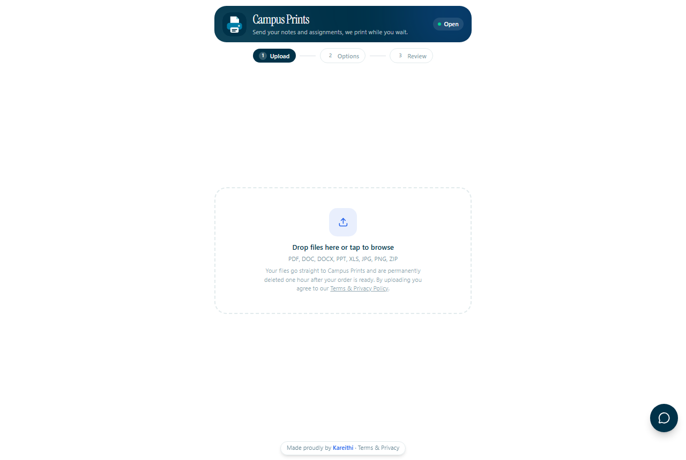
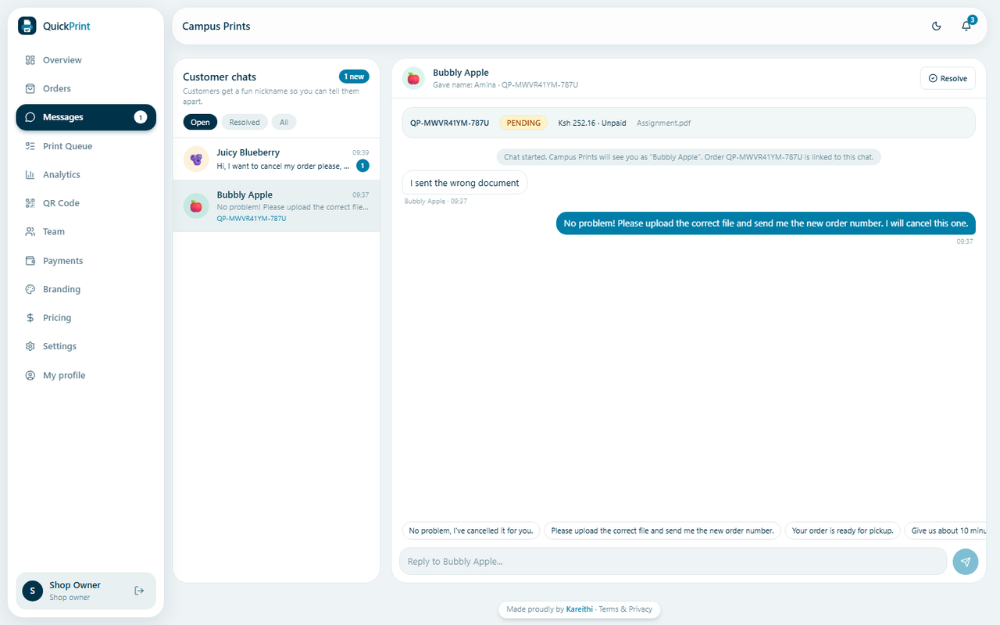
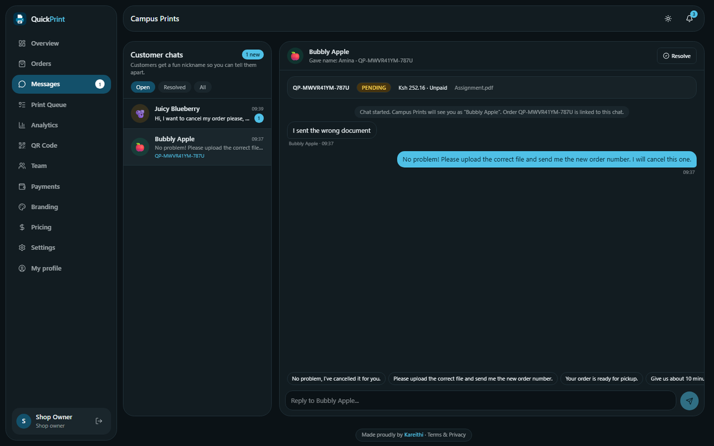
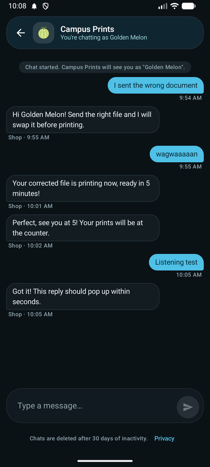
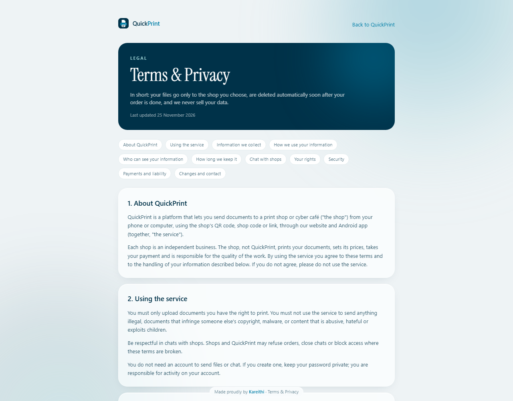

# QuickPrint Web

**A print-shop management and customer ordering portal.** QuickPrint helps cyber cafés,
print shops, universities, and libraries manage incoming print jobs from upload through
pickup.

Built with Next.js 16, React 19, and Tailwind CSS 4. Customers can also use the
[QuickPrint Android app](https://github.com/Brian-Kareithi/QuickPrint-Android), which talks to the same backend.

## Screenshots

**Customer upload portal** (`/shop/[slug]`). The chat button sits at the bottom right and opens the chat as a popup.



**Customer chats** (`/dashboard/messages`). Each customer gets a fruity nickname, and linked orders show above the conversation.

| Light | Dark (flat, no gradients) |
|:---:|:---:|
|  |  |

**The same chat from the customer's Android phone**

 

**Terms & Privacy** (`/terms`)



## Features

- Customer file-upload portal with shop-specific branding, print options, pricing, and order tracking
- Live print queue and searchable order management
- Payment setup for cash, M-Pesa, Airtel Money, and bank transfers, with payment status tracking
- Shop QR codes, downloadable artwork, and printable posters
- Dashboard analytics for revenue, orders, peak hours, and printer utilization
- Shop settings, team access, branding, and platform administration
- Customer ↔ shop chat: customers chat as guests with a fun nickname (for example *Cute Pineapple 🍍*); owners and cashiers reply from a live inbox with unread badges
- Terms & Privacy page covering data collection, retention and rights under the Kenya Data Protection Act 2019
- Flat dark mode for the signed-in portal (no gradients or glows)
- Live message alerts: a dashboard-wide listener shows a toast with each new customer message (click to open the chat), refreshes the Messages badge instantly, and can send desktop notifications when the tab is in the background
- Unread count in the browser tab: `(3) QuickPrint` plus a red badge on the tab icon (owners: unread chats + notifications; customers: unread shop replies)
- Customer chat opens as a popup with a floating header and composer; light "liquid glass" surfaces, subtle animations and loading skeletons that mirror each page's layout

## Quick start

```bash
npm install
```

Create a `.env.local` file in the project root:

```env
NEXT_PUBLIC_API_URL=http://localhost:4000/api
NEXT_PUBLIC_APP_URL=http://localhost:3000
```

Start the development server:

```bash
npm run dev
```

Open [http://localhost:3000](http://localhost:3000).

## Configuration

| Variable | Purpose | Default |
|----------|---------|---------|
| `NEXT_PUBLIC_API_URL` | Backend base URL. The client adds `/api` if it is not present. | `http://localhost:4000/api` |
| `NEXT_PUBLIC_APP_URL` | Public app URL embedded in shop QR codes. Set this to a domain or LAN address customers can reach. | Current browser origin |

In production, configure `NEXT_PUBLIC_APP_URL` to the deployed public address before generating shop QR codes. `localhost` only works on the machine running the app.

## Application routes

### Public and customer

| Route | Description |
|-------|-------------|
| `/` | Product landing page |
| `/auth/login` | Sign in |
| `/auth/register` | Create an account |
| `/shop/[slug]` | Shop-branded customer upload and ordering portal, with a chat button |
| `/terms` | Terms & Privacy Policy (linked from the site footer and the Android app) |
| `/my-orders` | Customer order history |

### Shop dashboard

| Route | Description |
|-------|-------------|
| `/dashboard` | Shop overview and onboarding checklist |
| `/dashboard/orders` | Search and manage orders, including payment status |
| `/dashboard/messages` | Customer chats inbox (`?c=<id>` opens a specific chat; offers to turn on desktop alerts) |
| `/dashboard/queue` | Print queue and job status updates |
| `/dashboard/analytics` | Revenue, order, peak-hour, and utilization charts |
| `/dashboard/payments` | Configure customer payment instructions |
| `/dashboard/qrcode` | Customer link, QR downloads, and printable poster |
| `/dashboard/branding` | Shop theme and branding |
| `/dashboard/pricing` | Per-item print pricing |
| `/dashboard/settings` | Shop information and settings |
| `/dashboard/team` | Team and cashier access |

### Administration

| Route | Description |
|-------|-------------|
| `/admin` | Platform administration |
| `/admin?tab=shops` | Shop management |
| `/admin?tab=retention` | Data retention controls |

Other routes include `/notifications` for the notification center.

## Development commands

```bash
npm run dev      # Start the local development server
npm run lint     # Run ESLint
npm run build    # Create a production build
npm start        # Serve the production build
```

## Docker

```bash
docker build -t quickprint-web .
docker run --env-file .env.local -p 3000:3000 quickprint-web
```

The browser-tab and iOS home-screen icons are generated by `app/icon.tsx` and
`app/apple-icon.tsx`.
